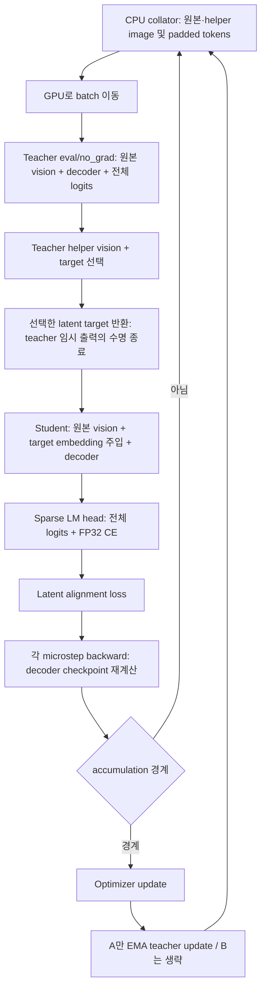

# Stage 1 메모리 사용 경로 비교 — 2026-09-14

**주된 절감 방향은 GPU당 microbatch 4→1에 따른 padded activation·vision 입력·teacher/student logits 축소다. 추가로 batch 1에서는 CE용 contiguous 복사가 사라진다. 현재 코드가 54GB를 상한으로 설정한 것은 아니다. 반대로 ZeRO-3→1과 sample-stable dropout은 메모리 절감으로 분류할 수 없다.**

이 문서는 사용자 지정 보고서의 실제 DoRA 실행과 현재 root repository의 재현 실행을 비교한다. `ILVR-ours1`의 나중 소스 snapshot이나 `.worktrees/ours1`의 Stage 2를 과거 실행 코드로 대신 사용하지 않는다. 9월 2일 batch-1 / checkpoint-431 실행의 약 95GB 관측은 별도이며, 아래 결과로 그 실행의 원인까지 증명하지 않는다.

## 1. 비교 대상과 증거

| 항목 | A: 타 서버 보고서의 DoRA | B: 현재 Stage 1 재현 |
|---|---|---|
| 실행 | `outputs/stage1-timed/dora-3epoch` | `stage1-reproduce-mn-egb8-s431-lr5e5-20260914-055210` |
| 실행 commit | `ca1183e13a0f63018cba210f81640b526bc43a44` | `c21b4e5c311204df4281317219b3f4a6b95e4d3b` |
| GPU | B200 × 2 | H100 NVL × 4, 두 노드 |
| GPU당 microbatch | **4** | **1** |
| Gradient accumulation | 2 | 2 |
| Global batch | 16 | 8 |
| 학습 | 3 epochs, 648 updates, LR 1e-5 | 1 epoch, 431 updates, LR 5e-5 |
| Tuning | Qwen2.5-VL 3B, DoRA r32/alpha64/dropout0.05 | 동일 구조·DoRA 설정 |
| ZeRO | 3, CPU/NVMe offload 없음 | 1, CPU/NVMe offload 없음 |
| Teacher | EMA tau=0.999, 매 successful update 갱신 | tau=1.0, 가중치 고정 |
| Checkpointing | native layer checkpoint, reentrant | native layer checkpoint, non-reentrant + stochastic context |
| Precision / attention | BF16 / FlashAttention 2 | BF16 / FlashAttention 2 |
| 메모리 증거 | max rank peak allocated **143.95GiB** | 학습 중 `nvidia-smi` 약 54GB 관측; 동일 방식의 전체 peak 미수집 |

A의 두 rank peak allocated는 154567055360 / 153118799872 bytes, reserved는 160329367552 / 158630674432 bytes다. Full 열의 162.64GiB는 3,085,389,824개 파라미터를 학습하는 별도 full-tuning 실행이며, DoRA끼리 비교하는 주 대조군은 143.95GiB다.

근거: [지정 보고서](/raid/workspace/ILVR/ILVR/results/stage1-evaluation/stage1-full-vs-dora-20260828/report.md:23), [A 원본 evidence](/raid/workspace/ILVR/ILVR/.worktrees/vcsd-ilvr-stage2/outputs/stage1-timed/dora-3epoch/evidence.json), [B launch manifest](../results/stage1-reproduce-mn-egb8-s431-lr5e5-20260914-055210/run.json).

A의 기록된 commit에서 소스를 추출하고 현재 파일과 SHA-256을 비교했다. **Qwen `modeling_qwen2_5_vl.py` 전체가 양쪽에서 byte 단위로 같다.** 기록된 torch 2.7.1+cu128, transformers 4.50.0.dev0, accelerate 1.10.1, deepspeed 0.18.0, peft 0.17.1, trl 0.15.2도 현재 설치 버전과 같다. 버전 문자열만으로 모든 package 소스·CUDA kernel·환경이 동일하다고 주장하지 않는다. 이 대조에서 거대한 VRAM 차이를 막연한 Transformers 버전 호환성으로 설명할 근거는 없다.

## 2. 실제 실행 순서

A는 teacher에 padded batch 전체를 한 번에 넣는다. B는 target builder에서 sample별 unpadded 입력으로 teacher와 helper vision을 호출한다. B의 실제 microbatch는 1이다. Teacher 단계와 student 단계는 순차 실행되므로 두 단계의 독립적인 최대 임시 메모리를 단순 합산해서 peak를 계산하면 안 된다. 다만 두 모델의 가중치는 모두 상주한다.

## 3. 항목별 증감 비교

아래 화살표는 A에서 B로 바뀌었을 때의 GPU당 메모리 방향이다. `미정`은 실행 방식의 차이는 확인했으나 방향이나 크기를 단정할 수 없다는 뜻이다.

| 항목 | A의 동작 | B의 동작 | B의 메모리 영향 |
|---|---|---|---|
| 1. 동시 처리 샘플 | GPU당 4개 | GPU당 1개 | **↓ 주요 요인.** hidden activation, projected Q/K/V, logits 및 해당 샘플의 이미지 텐서가 작아진다. 모델 상주 메모리까지 1/4이 되는 것은 아니다. |
| 2. Text padding | 4개 중 최대 길이에 맞춰 padding | microbatch 1이라 샘플 간 padding 없음 | **↓.** 특히 길이가 다른 네 샘플의 조합에서 불필요한 padded positions가 줄어든다. FA2가 attention 내부 padding을 처리해도 LM head의 전체 `[B,T,V]` 출력까지 사라지는 것은 아니다. |
| 3. CPU collator | full/original/helper processor 호출을 batch 단위로 수행 | sample별 processor 호출 후 결합 | GPU 직접 영향은 주로 최종 텐서 shape를 통한다. processor 중간 Python/PIL/CPU 텐서를 GPU VRAM 절감으로 합산하지 않는다. |
| 4. 원본·helper 이미지 | 네 샘플에 속한 이미지들을 GPU batch로 전달 | 한 샘플의 이미지들을 전달 | **↓ 경향.** 이미지 수·해상도는 가변이다. teacher helper vision 임시 activation도 batch 구성의 영향을 받는다. |
| 5. Teacher language forward | padded batch 전체를 호출 | sample별 unpadded slice로 호출 | **↓.** 실제 4→1 외에, 같은 microbatch로 맞추더라도 sample-isolated teacher는 샘플 간 padding 및 동시 teacher 출력 보존을 줄이는 구조다. 입력 batch 자체는 여전히 상주할 수 있다. |
| 6. Teacher helper vision | 전체 batch의 helper를 한 번에 처리 | 해당 sample의 helper만 처리 | **↓.** 단, sample 하나에 helper가 많으면 B에서도 큰 vision 작업이 된다. |
| 7. Teacher 모델 복제 | student deepcopy, eval, requires_grad=False, GPU 배치 | 같은 방식 | **공통 고정비.** B의 frozen teacher는 제거·CPU offload·student와 weight sharing을 뜻하지 않는다. |
| 8. Teacher 불필요 logits | labels가 없어도 전체 logits 생성, helper 처리 동안 출력 객체가 참조 | 여전히 생성하며 sample helper 처리 동안 참조 | 연산 자체는 **공통 비용**, 실제 B/T 축소가 절감 요인. B가 teacher LM head를 생략하는 최적화는 없다. |
| 9. Teacher hidden states | inner decoder는 모든 layer 출력을 임시 수집; outer Qwen 출력은 마지막 hidden tensor | 동일 Qwen 코드 | **공통 비용**, B/T 축소로 감소. helper 처리 내내 모든 layer 출력이 남는다고 해석하면 잘못이다. |
| 10. Student decoder | `[4,T_max,H]`, block checkpoint | `[1,T,H]`, block checkpoint | **↓ 주요 요인.** checkpoint가 있어도 layer 입력, 마지막 hidden, loss로 연결되는 텐서는 필요하다. |
| 11. Sparse output rows | 전체 base logits 뒤 `torch.index_add`로 전체 크기 출력 생성 | 동일 | **공통 비용**, B/T 축소로 감소. sparse는 trainable rows가 3개라는 뜻이며 logits vocabulary를 3개로 줄인다는 뜻이 아니다. |
| 12. FP32 logits / CE | 전체 logits를 FP32로 바꾸고 CE | 실제 microbatch 1도 동일 경로 | **↓ 주요 요인.** 크기가 B×T×V에 비례한다. BF16 학습이라도 이 FP32 비용이 남는다. |
| 13. Shift 후 contiguous | B=4의 `logits[:, :-1, :]`는 비연속이라 복사 | B=1 slice는 연속이라 복사 불필요 | **↓ 추가 요인.** CPU storage probe로 확인. |
| 14. CE chunk checkpoint | A는 batch labels를 그대로 모델에 넘겨 full CE | B에는 token 1024개씩 CE checkpoint 경로가 있으나 **batch>1일 때만** 진입 | 현재 run에서는 **미사용**. 지금의 절감 공로로 계산하면 안 된다. 같은 batch>1로 비교할 때는 별도 구현상의 절감 요인이다. |
| 15. Native checkpoint 방식 | use_reentrant=True | **use_reentrant=False**, context_fn 사용 | **미정.** 양쪽 모두 checkpoint가 켜져 있다. 재계산·autograd 저장 방식은 다르지만 B가 항상 더 적은 VRAM을 쓴다고 단정하지 않는다. |
| 16. Dropout | PEFT 일반 dropout 0.05 | sample-stable dropout 0.05 | **절감 요인 아님.** B는 activation dtype mask와 FP32 random draws 등을 명시적으로 생성한다. 같은 shape에서 일시 할당을 늘릴 수도 있다. context는 mask를 전 step에 걸쳐 캐시하지 않고 invocation 메타데이터를 관리한다. |
| 17. Student vision freeze | vision requires_grad=False | 동일 | **공통 절감.** 원본 vision forward 자체는 여전히 실행된다. teacher도 no_grad지만 forward 작업 공간은 필요하다. |
| 18. Student ZeRO | ZeRO-3: 파라미터·gradient·optimizer state 분할 및 gather/prefetch | ZeRO-1: 파라미터와 gradient 복제, optimizer state 분할 | 상주 student 파라미터/gradient 측면 **↑ 방향**. B가 적게 쓰는 근거로 ZeRO-1을 들 수 없다. 반면 B에는 ZeRO-3 파라미터 gather/prefetch가 없어 transient 비용은 줄 수 있다. 합계 방향은 별도 측정 대상이다. |
| 19. 통신 buffer | overlap/contiguous grads, reduce bucket 5e8, prefetch bucket 5e7, persistence 설정 | overlap/contiguous grads, reduce bucket 5e8 | reduce bucket 명목 크기는 같다. A의 parameter gather/prefetch 관리 비용은 B에서 사라진다. bucket 숫자는 parameter element 수이며 항상 전부 상주하는 byte 수가 아니다. |
| 20. Optimizer rank 분할 | 2 ranks | 4 ranks | 동일 trainable state의 rank별 분할량은 **↓**. 다만 DoRA trainable params는 약 60.9M라 수십 GiB 차이의 주 설명으로 보기 어렵다. |
| 21. EMA 갱신 | tau=.999, optimizer update마다 선택한 DoRA/latent parameters 갱신; ZeRO-3이면 필요한 gather | tau=1, update 생략 | **↓ 보조 요인.** 갱신 연산·일시 gather 비용이 사라진다. teacher 전체 가중치 상주는 그대로다. 학습 target의 시간 변화도 달라지는 설정이므로 순수 메모리 최적화와 구분한다. |
| 22. Alignment / diagnostics | latent 위치 선택, cosine loss, 작은 진단 scalar | sample-balanced 처리 및 추가 선택 메타데이터; 실제 B=1 | 선택된 latent tensor는 `[selected,H]` 수준이다. 대형 vocabulary logits보다 작다. B=1에서는 batch 평균 차이를 메모리 주원인으로 보지 않는다. |
| 23. Gradient accumulation | 2 microsteps, 각 microstep backward | 동일 | **직접 절감 없음.** 네트워크 graph 두 개를 마지막까지 보관하는 방식이 아니며 gradient를 누적한다. |
| 24. Epoch / LR / update 수 | 3 / 1e-5 / 648 | 1 / 5e-5 / 431 | tensor shape를 직접 줄이지 않는다. 실행 기간과 샘플 조합·allocator 이력은 달라지지만 VRAM이 epoch 수만큼 누적되는 설계는 아니다. |
| 25. Checkpoint 저장 | 마지막 save, ZeRO-3 gather_16bit 설정 | step431 resume state 저장 + final adapter save, teacher 선택 파라미터 CPU snapshot | 저장 시 transient·I/O·CPU RAM 경로가 다르다. B의 resume 저장이 더 많은 state를 다룰 수 있다. steady-state 54GB의 주원인으로 단정할 수 없다. |
| 26. KV cache | composition에서 use_cache=False, teacher도 해당 config 복제 | 동일 | **공통 절감.** A에서 KV cache가 계속 쌓였기 때문이라는 설명은 이 실행 코드와 맞지 않는다. |
| 27. GPU / 메모리 계측 | B200, PyTorch 최대 allocated/reserved | H100 NVL, 관측된 nvidia-smi device 사용량 | **직접 수치 분해 불가.** CUDA 작업 공간·allocator 차이가 가능하다. 순간 device usage와 lifetime tensor allocation peak는 다른 측정이다. |

코드 위치: [A collator](../results/stage1-memory-comparison-20260914/historical-source/src/stage1/data.py), [B collator](../src/stage1/data.py:196), [A teacher targets](../results/stage1-memory-comparison-20260914/historical-source/src/stage1/targets.py:111), [B teacher targets](../src/stage1/targets.py:193), [A trainer](../results/stage1-memory-comparison-20260914/historical-source/src/stage1/trainer.py:201), [B loss 분기](../src/stage1/trainer.py:405), [공통 sparse head](../src/stage1/token_rows.py:86), [공통 Qwen CE](../transformers/src/transformers/models/qwen2_5_vl/modeling_qwen2_5_vl.py:2338).

## 4. 큰 텐서가 실제로 얼마나 달라지는가

vocabulary 151668, 동일 길이 T=8192를 **설명용으로 가정**하면 FP32 logits 한 개는 다음과 같다. 이 T가 양쪽 실제 peak 샘플 길이였다는 뜻은 아니다.

| 텐서 | microbatch 4 | microbatch 1 |
|---|---:|---:|
| FP32 logits `[B,8192,151668]` 한 개 | 18.514GiB | 4.629GiB |
| Shift contiguous 별도 버퍼 | 약 18.512GiB 추가 | 별도 복사 없음 |

한 종류의 logits와 해당 shift 복사만으로도 batch 조건에 따라 수십 GiB 차이가 날 수 있는 경로다. 여기에 CE backward에 필요한 텐서, BF16 sparse-head 출력, decoder activation, vision 임시 작업 공간이 더해진다. **이 표를 단순 합산해 143.95GiB의 실측 원인별 분해라고 주장하지 않는다.** tensor 수명·allocator 재사용·checkpoint 경계가 다르기 때문이다.

일반적인 Adam의 두 FP32 moment만 예로 들면 trainable parameter 60,911,616개에 대해 2-way 분할은 rank당 약 232MiB, 4-way는 약 116MiB다. master weights·gradient·bucket·실제 dtype은 별도지만, optimizer 분할만으로 약 90GiB 차이를 설명하는 것은 맞지 않는다.

## 5. 추가로 확인한 공통 비용과 해석상 주의점

- **Teacher frozen은 공짜가 아니다.** B는 EMA 갱신만 생략한다. 매 batch teacher language/vision forward는 계속 실행한다. teacher의 큰 전체 logits를 제거한 것은 아니다.
- **Teacher 전체 hidden-state stack을 계속 보존하는 것도 아니다.** 공통 Qwen inner decoder는 `output_hidden_states=True`에서 layer별 출력을 모으지만 outer Qwen이 반환하는 `hidden_states`는 마지막 tensor다. CPU tiny Qwen에서도 inner count=3인 2-layer 모델이 outer `[B,T,H]` tensor만 반환했다. 그러므로 helper vision 구간에 모든 layer hidden state가 남아 있다고 메모리를 계산하면 과대 추정이다.
- **Helper grouping은 vision 입력 chunking이 아니다.** `helper_group_L=256`은 이미 계산된 vision features에 적용되는 grouping이다. vision forward 전에 이미지들을 256개 token씩 나눠 처리해 peak를 제한하는 옵션이 아니다.
- **Sequence 설정만으로 truncation을 주장하지 않는다.** A SFT 값은 CLI의 8192, B SFT 값은 32768이다. 하지만 양쪽 custom collator의 processor 호출은 `truncation=False`, SFT dataset 준비는 skip이다. 이 설정 숫자만으로 A/B의 실제 GPU token 길이나 필터링을 판단할 수 없다.
- **Sample-isolated collator가 student를 sample별로 실행하는 것은 아니다.** 현재 collator가 각 sample을 독립 전처리해도 마지막에는 batch로 결합한다. B에서 student가 1개씩 실행되는 직접 이유는 실제 microbatch=1이다. teacher target builder는 별도로 sample별 forward를 수행한다.
- **DoRA는 forward를 작은 모델로 바꾸지 않는다.** base decoder와 LM head 연산 및 input gradient 전달은 계속 필요하다. sparse output을 위해 untied LM head를 두는 구조도 양쪽 공통이다. Full 대비 작은 trainable parameter 수만으로 activation·logits 메모리가 같은 비율로 줄지 않는다.
- **현재 dropout 변경은 메모리 절감으로 홍보할 항목이 아니다.** 동일 sample의 dropout 재현을 위한 구현이며, mask/draws의 일시 비용이 있다. native checkpoint가 내부 저장을 줄여도 local forward의 순간 할당은 존재한다.
- **과거 peak 관측 시점은 final save 이후다.** A composition은 train → final save → `max_memory_allocated/reserved` 수집 순서다. 해당 수치는 순수 decoder forward만의 peak가 아니며 warmup/초기화/저장 중 발생한 allocation도 측정 이력에 들어갈 수 있다. B의 nvidia-smi 관측과 직접 비율을 계산하지 않는다.

Checkpoint/dropout/EMA 근거: [A checkpoint 설정](../results/stage1-memory-comparison-20260914/historical-source/src/stage1/composition.py:339), [B checkpoint 설정](../src/stage1/composition.py:352), [B dropout](../src/stage1/equivalence.py:859), [B teacher 복제](../src/stage1/ema.py:423), [B EMA 생략](../src/stage1/trainer.py:834), [A peak 수집](../results/stage1-memory-comparison-20260914/historical-source/src/stage1/composition.py:828), [B ZeRO config](../configs/deepspeed_zero1.json), [A ZeRO config](../results/stage1-memory-comparison-20260914/historical-source/configs/config_stage3.json).

## 6. 검증 범위와 판단

직접 확인한 것은 실행 evidence의 설정·peak, 기록된 commit의 코드, 현재 source hash, dependency 버전, 그리고 작은 CPU 연산의 storage/shape 동작이다. 실행 commit 소스는 [historical-source](../results/stage1-memory-comparison-20260914/historical-source/)에 추출했고 [source-manifest.json](../results/stage1-memory-comparison-20260914/source-manifest.json)에 hash를 남겼다.

[CPU probe](../results/stage1-memory-comparison-20260914/probe.py) 및 [출력](../results/stage1-memory-comparison-20260914/cpu-probe.json):

1. shift contiguous: B=1 storage 공유, B=4 추가 storage 복사.
2. 실제 sparse head: base logits와 index_add 출력의 storage가 다름.
3. 공통 tiny Qwen teacher: 전체 logits 생성, outer hidden states는 tensor, KV cache 없음, no_grad 출력.

실행 명령: `PYTHONPATH=src OMP_NUM_THREADS=1 ./venv/ilvr-venv/bin/python results/stage1-memory-comparison-20260914/probe.py`. 이는 CPU 진단이며 분산 GPU 학습 또는 peak 재현 테스트가 아니다. 학습 코드·launch 설정·가중치는 수정하지 않았다.

**판단:** 이 8월 28일 보고서의 높은 메모리는 GPU당 4개 샘플을 처리하는 실제 코드 경로와 잘 맞는다. 현재의 낮은 메모리를 설명하는 우선 요인은 microbatch/padding 및 logits/CE 복사 차이이며, teacher sample 분리와 EMA 갱신 생략은 추가 절감 방향이다. ZeRO-1·dropout·저장 경로까지 모두 절감이라고 묶으면 잘못이다. 같은 데이터 row·shape·측정 구간의 GPU profile 없이 항목별 실측 GiB나 기여율을 배정하지 않는다.
