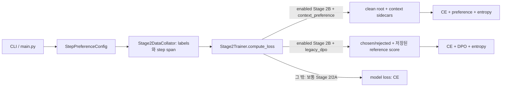

# ours1의 현재 preference loss: 실행 경로와 수식

이 문서는 ours1 `6f8c77bf2bc3ed2352215616e72f4d693937e404`의 **코드 경로**를 기술한다. 수치가 명시된 실제 실험 기록을 분석한 문서가 아니다. 주 경로는 Stage 2B `context_preference`이며, 기존 `legacy_dpo`는 뒤에서 별도로 설명한다. 코드의 구조적 기본값, CLI의 수치 기본값, 새 실험에 적용해야 하는 운영 정책을 구분한다.

## 1. 어느 경로가 실행되는가



`StepPreferenceConfig`의 `enabled=False`, `mode=stage2a`, `objective=context_preference`는 각각 별개 필드다. **objective의 기본 문자열만으로 preference가 켜지지 않는다.** `is_stage2b = enabled ∧ mode==stage2b`이고 `is_context_preference`는 여기에 objective 조건을 더한다. `main.py`는 Stage 2B일 때만 collator에 preference 메타데이터를 요구하고 Trainer에 구성을 전달한다. Trainer는 context → legacy Stage 2B → 일반 CE 순서로 분기한다. [config.py](../src/step_preference/config.py#L64), [config.py](../src/step_preference/config.py#L299), [main.py](../src/main.py#L845), [main.py](../src/main.py#L1120), [trainer.py](../src/stage2/trainer.py#L1380)

| 구분 | 현재 코드에서 읽히는 값 또는 조건 | 해석 |
|---|---|---|
| context Stage 2B 구조적 기본값 | `until_next_latent`, `clean_prefix`, V-only, V-off에서 START/END도 숨김, 원본 이미지 차단은 꺼짐 | `enabled=True, mode=stage2b`를 실제로 선택한 경우에만 성립 |
| CLI/설정 수치 기본값 | β=0.1, preference 가중치=1.0, entropy 가중치=0.1, entropy margin=0.1, preference margin=0 | 스크립트나 환경의 명시값 및 재개 설정이 이를 바꿀 수 있음 |
| 새 preference 실험의 상위 운영 정책 | β=0.5, preference 가중치=1.0; 검증된 Stage 2 프로필은 entropy 가중치=0 등 | launch 시 effective 값의 확인이 필요하며, 코드 fallback이나 기존 run의 실제값을 뜻하지 않음 |

구조적 기본값은 [config.py](../src/step_preference/config.py#L68), [config.py](../src/step_preference/config.py#L104), [config.py](../src/step_preference/config.py#L318)에 있고 CLI 기본값은 [utils_deepseed.py](../src/utils_deepseed.py#L55)에 있다. `until_next_latent`의 실행 설정은 새 구성에 `concatenated-v1`, latent checkpoint on, sidecar checkpoint off를 산출하며 native checkpoint가 동시에 켜져 있으면 거절한다. 저장된 재개 설정은 별도 우선 경로다. [execution.py](../src/step_preference/execution.py#L17), [main.py](../src/main.py#L569)

## 2. 공통 데이터와 선택 토큰

Stage 2 collator는 원본 이미지와 렌더링된 채팅을 processor에 넣어 `input_ids`를 만든다. helper 이미지는 모델 입력에 전달하지 않는다. assistant 앞의 프롬프트와 padding, latent body의 PAD 위치에는 CE label `-100`을 붙인다. START/END는 `supervise_latent_boundaries`가 참이면 CE 대상이고, 거짓이면 가린다. preference가 켜졌을 때만 fast tokenizer의 offset mapping과 processor 결과의 동일성을 확인하고 step span을 붙인다. [data.py](../src/stage2/data.py#L214), [data.py](../src/stage2/data.py#L309), [data.py](../src/stage2/data.py#L345)

`concatenated-v1`은 인접한 텍스트 항목 사이에 별도 구분 문자열을 넣지 않는다. `until_next_latent`에서 step \(k\)의 latent END 토큰 위치를 \(e_k\), 다음 latent START 위치를 \(s_{k+1}\)라 두면 preference target은 반열림 구간

\[
T_k=[e_k+1,s_{k+1}),\qquad
T_{K-1}=[e_{K-1}+1,a_{\rm end})
\]

이다. \(a_{\rm end}\)는 assistant **본문의 끝**이므로 마지막 답변 텍스트는 들어가고 뒤의 채팅 종료/EOS 토큰은 들어가지 않는다. 단순한 즉시 다음 text 항목보다 넓을 수 있으며, 중간의 인접 text/text 항목을 함께 포함한다. 다음 step의 `prev_text`는 직전 step의 **전체 target 구간** \([e_{k-1}+1,s_k)\)이다. 중간에 인접 text/text 항목이 여러 개 있어도 마지막 항목만 고르지 않는다. [spans.py](../src/step_preference/spans.py#L205), [spans.py](../src/step_preference/spans.py#L229), [spans.py](../src/step_preference/spans.py#L281)

offset 검증은 이 scope에서 assistant 양 끝, latent START/END, body 경계 등을 지나는 토큰을 거절한다. 인접 text/text 내부 경계는 이 scope의 경계 집합에 넣지 않으므로, 그 경계를 가로지르는 토큰을 preference span에서 별도 제외하지 않고 전체 target에 포함할 수 있다. 이 허용 범위를 모든 경계 토큰의 무조건적 제외로 해석하면 안 된다. 모든 span은 정확하고 연속된 token interval이어야 하며 target은 비어 있으면 오류다. [spans.py](../src/step_preference/spans.py#L152), [spans.py](../src/step_preference/spans.py#L179), [spans.py](../src/step_preference/spans.py#L188), [packing.py](../src/step_preference/packing.py#L100)

논리 target \(t\in T_k\)는 teacher forcing으로 주어진 **동일한** `input_ids[t]`를 두 context에서 평가한다. 예측 query는 \(q=t-1\)이다. root의 선택 위치와 sidecar target ID가 이 인덱스 관계를 명시한다. CE는 위 preference span만의 평균이 아니라 root 전체에서 label이 `-100`이 아닌 assistant 토큰에 대한 causal cross entropy 평균이다. 채팅 종료 토큰도 label이 유지되면 CE에 포함되지만 위 preference target의 assistant 본문에는 포함되지 않는다. 따라서 START/END의 CE 감독 여부와 preference target 선택은 별개다. [sidecar.py](../src/step_preference/sidecar.py#L50), [sidecar.py](../src/step_preference/sidecar.py#L251), [modeling_qwen2_5_vl.py](../transformers/src/transformers/models/qwen2_5_vl/modeling_qwen2_5_vl.py#L2551)

## 3. clean-prefix V-only context 비교의 실제 forward

Trainer는 한 샘플의 step 메타데이터가 `{"span": span}`만 갖는지 검사하고 `build_context_sidecar_plan`을 만든 뒤 **한 번** `model(**call)`을 호출한다. 이 호출 안에서 Qwen Stage 2는 연속 latent recurrence를 만든 후 clean root decoder를 계산한다. root는 CE용 hidden 전체 및 target predictor logits를 산출한다. 이어 sidecar scorer가 root의 layer별 K/V와 clean latent embedding을 재사용하여 V-off suffix를 평가한다. Trainer는 sidecar 결과를 받아 objective를 줄인다. [trainer.py](../src/stage2/trainer.py#L586), [modeling_qwen2_5_vl.py](../transformers/src/transformers/models/qwen2_5_vl/modeling_qwen2_5_vl.py#L2480), [modeling_qwen2_5_vl.py](../transformers/src/transformers/models/qwen2_5_vl/modeling_qwen2_5_vl.py#L2521), [stage2_shared_prefix.py](../transformers/src/transformers/models/qwen2_5_vl/stage2_shared_prefix.py#L294)

각 step \(k\)의 V-off suffix는 `target_start-1`부터 `target_end-2`까지의 query 토큰을 다시 계산한다. clean root K/V 중 해당 query **이전** 위치만 조상으로 보이게 하고, 현재 step의 latent body \([latent\_start,latent\_end)\)를 key에서 가린다. 구조적 V-only 기본값인 boundary suppression이 켜지면 차단 구간은 \([latent\_start-1,latent\_end+1)\), 즉 START와 END까지 확장된다. 첫 replay embedding도 0으로 바꿔 END query 자신의 입력 내용이 새 경로로 새지 않게 한다. sidecar 내부의 suffix query는 서로 causal하게 보되 다른 branch의 suffix를 보지 않는다. [sidecar.py](../src/step_preference/sidecar.py#L50), [sidecar.py](../src/step_preference/sidecar.py#L309), [sidecar.py](../src/step_preference/sidecar.py#L339), [stage2_shared_prefix.py](../transformers/src/transformers/models/qwen2_5_vl/stage2_shared_prefix.py#L141)

이는 **현재 step의 직접 latent K/V 접근을 차단**한다는 뜻이다. 이전 clean text나 이전 latent, 원본 이미지가 이미 clean root의 조상 상태에 담은 정보는 간접 경로로 남을 수 있다. `block_original_image=False`가 기본이므로 원본 이미지 key 자체도 보이는 범위에서는 남는다. 따라서 V-off를 원본 시각 정보가 완전히 제거된 반사실이라고 부르면 과장이다. V+T를 명시하면 textual-off sidecar가 해당 step의 `prev_text` key 구간 전체를 가린다. `until_next_latent`에서 후속 step의 이 구간은 직전 step의 전체 target \([e_{k-1}+1,s_k)\)이며, 여러 인접 text 항목을 모두 포함한다. [sidecar.py](../src/step_preference/sidecar.py#L62), [sidecar.py](../src/step_preference/sidecar.py#L265), [config.py](../src/step_preference/config.py#L77)

`use_cache=False`는 보통의 추론용 cache를 반환하지 않는 설정이다. clean-prefix 공유 실행에서는 별도의 `stage2_capture_kv=True`가 root decoder 각 층의 K/V를 differentiable tensor로 수집하고, suffix decoder는 `stage2_prefix_key_values`를 입력받는다. K/V에는 `.detach()`가 없으며 suffix와 clean score의 gradient가 trainable decoder/latent 경로로 흐른다. native checkpoint off / selective latent checkpoint on / clean-prefix sidecar checkpoint off가 `until_next_latent`의 새 실행 설정이다. 이 off 설정이어도 **내부 K/V 수집은 켜진다.** [modeling_qwen2_5_vl.py](../transformers/src/transformers/models/qwen2_5_vl/modeling_qwen2_5_vl.py#L1364), [modeling_qwen2_5_vl.py](../transformers/src/transformers/models/qwen2_5_vl/modeling_qwen2_5_vl.py#L1565), [stage2_shared_prefix.py](../transformers/src/transformers/models/qwen2_5_vl/stage2_shared_prefix.py#L301), [execution.py](../src/step_preference/execution.py#L34)

## 4. 점수와 preference 식

step \(k\), modality \(m\in\{V,T\}\), target 토큰 수 \(n_k=|T_k|\)에 대해 clean/on과 off score는 같은 정답 토큰을 사용한다. \(z^{c}_{k,t}\), \(z^{m-}_{k,t}\)는 위치 \(t-1\)의 vocabulary logits라 두면

\[
\ell_k^{c}=\frac1{n_k}\sum_{t\in T_k}
 \log\operatorname{softmax}(\operatorname{float32}(z^c_{k,t}))_{x_t},\qquad
\ell_k^{m-}=\frac1{n_k}\sum_{t\in T_k}
 \log\operatorname{softmax}(\operatorname{float32}(z^{m-}_{k,t}))_{x_t}.
\]

첫 식은 root 선택 logits, 둘째 식은 sidecar가 선택한 hidden을 `lm_head`로 투영한 logits를 쓴다. float32 `log_softmax`와 `gather` 후 **토큰 평균**을 낸다. 부호가 음수인 평균 log probability이지 probability 평균이나 token log probability 합이 아니다. target 길이가 달라도 step당 score 하나가 만들어진다. [trainer.py](../src/stage2/trainer.py#L116), [trainer.py](../src/stage2/trainer.py#L693), [stage2_shared_prefix.py](../transformers/src/transformers/models/qwen2_5_vl/stage2_shared_prefix.py#L199)

차이 \(\Delta_{km}=\ell_k^c-\ell_k^{m-}\), margin \(\mu\), β>0일 때 쌍 손실은

\[
p_{km}=-\log\sigma\!\left(\beta(\Delta_{km}-\mu)\right)
=\operatorname{softplus}\!\left(-\beta(\Delta_{km}-\mu)\right).
\]

**margin을 먼저 빼고 그 전체에 β를 곱한다.** 활성 modality 집합 \(M\)은 기본 V-only면 \(\{V\}\), V+T면 \(\{V,T\}\)다. step이 \(K>0\)개이면

\[
L_{\rm pref}=\frac1{|M|}\sum_{m\in M}\frac1K\sum_{k=0}^{K-1} p_{km}.
\]

동일 step 수의 modality 평균이므로 V+T에서는 각 modality가 1/2의 가중치를 갖는다. 빈 step 집합이면 preference 항은 CE에서 만든 미분 가능한 0이다. [dpo_loss.py](../src/step_preference/dpo_loss.py#L122), [trainer.py](../src/stage2/trainer.py#L499)

한 쌍에 대해 \(u=\beta(\Delta-\mu)\)이면

\[
\frac{\partial p}{\partial \ell^c}=-\beta\sigma(-u),\qquad
\frac{\partial p}{\partial \ell^{m-}}=+\beta\sigma(-u).
\]

둘 다 현재 policy로 계산되며 reference score나 detach가 없다. 최소화할 때 clean 정답 평균 log probability는 높이고 off 정답 평균 log probability는 낮추는 방향이다. 실제 parameter gradient는 두 context가 공유하는 parameter 경로의 합이며 CE·entropy와도 합산된다. 예컨대 **β=0.5, μ=0**일 때 Δ=0이면 \(p=\log2\approx0.693147\), score별 미분은 \(-0.25,+0.25\)다. Δ=1이면 \(p\approx0.474077\), 미분은 약 \(-0.18877,+0.18877\)다. 이 β=0.5는 운영 정책의 예시값이지 특정 run의 관측값은 아니다. [dpo_loss.py](../src/step_preference/dpo_loss.py#L139)

이는 선택한 정답 target을 두 **context**에서 비교한다. 별도의 고정 reference 모델의 chosen/rejected log ratio를 빼는 전통적 DPO와 수식·데이터 모두 다르다. context 구성에서는 negative artifact가 금지되며, reference forward도 하지 않는다. [config.py](../src/step_preference/config.py#L226), [trainer.py](../src/stage2/trainer.py#L606)

## 5. entropy와 최종 목적함수

각 선택 predictor row에서 vocabulary **전체**의 Shannon entropy는

\[
H(z)=-\sum_v p_v\log p_v,\quad p=\operatorname{softmax}(\operatorname{float32}(z)).
\]

context 경로의 토큰 hinge는 \(h_{kmt}=\max(0,\eta+H(z^c_{k,t})-H(z^{m-}_{k,t}))\)다. off entropy가 clean보다 적어도 \(\eta\)만큼 **높아지도록** 요구한다. \(\eta\)는 entropy margin이며 preference margin \(\mu\)와 다르다. 이 항은 정답 토큰 확률의 entropy가 아니라 full-vocabulary 분포 entropy다. [trainer.py](../src/stage2/trainer.py#L139), [trainer.py](../src/stage2/trainer.py#L525)

context reducer는 먼저 **step 안의 토큰 평균**, 이어 **step 평균**, 마지막으로 **활성 modality 평균**을 쓴다:

\[
L_H=\frac1{|M|}\sum_{m\in M}\frac1K\sum_{k=0}^{K-1}
\frac1{n_k}\sum_{t\in T_k}h_{kmt},\qquad
L_{\rm total}=L_{\rm CE}+\lambda_{\rm pref}L_{\rm pref}+\lambda_H L_H.
\]

그러므로 긴 step의 entropy 토큰 수가 전체 항을 더 크게 차지하지 않는다. `clean_ce`는 별도 **전체 supervised label** 평균이다. V-only면 T 항은 목표식에서 빠지고 T 로그는 0이다. `K=0`이면 preference와 entropy는 0이고 `total=CE`다. \(\lambda_H=0\)이어도 이 코드 경로는 entropy 값을 계산·로깅할 수 있으며 objective gradient의 entropy 기여만 0이다. [trainer.py](../src/stage2/trainer.py#L499), [trainer.py](../src/stage2/trainer.py#L551), [modeling_qwen2_5_vl.py](../transformers/src/transformers/models/qwen2_5_vl/modeling_qwen2_5_vl.py#L2551)

예: 두 step의 entropy hinge 토큰값이 각각 `[0.1]`, `[0,0,0]`이면 V-only \(L_H=(0.1+0)/2=0.05\)이다. 토큰 전체를 한 번에 평균하면 0.025가 되므로 그 계산은 **현재 context 구현과 다르다**. 로컬 한 배치의 이 식만으로 분산 optimizer의 정확한 전역 분모를 단정할 수 없다. 부모 `Trainer.training_step`은 `compute_loss`를 호출한다. 이 모델이 `model_accepts_loss_kwargs=False`이고 별도 `compute_loss_func`가 없으면 gradient accumulation 수로 loss를 나눈 뒤 `accelerator.backward`를 호출한다. Stage2Trainer는 전달된 `num_items_in_batch`를 loss 계산에 사용하지 않는다. DeepSpeed일 때 `scale_wrt_gas=False`도 넘긴다. 실제 rank별 샘플/패딩 및 가속기 설정까지 확인해야 optimizer update의 전역 가중치를 주장할 수 있다. [trainer.py](../transformers/src/transformers/trainer.py#L3694), [trainer.py](../transformers/src/transformers/trainer.py#L3761)

## 6. 선택 가능한 다른 prefix 구성

| `prefix_mode` | 비교의 on/off 의미 | 점수·gradient·cache 경로 |
|---|---|---|
| `clean_prefix` | clean root target 대, 현재 step latent body(기본은 START/END도) key를 가린 suffix replay | root K/V 캡처를 재사용; score 양측 trainable. 원본 이미지와 clean 조상에 담긴 정보는 남을 수 있음 |
| `v_off_prefix` | 각 step의 clean latent embedding을 유지한 채 **전체 prefix를 두 번 재계산**: latent key가 보이는 evidence-on 대 숨긴 evidence-off | root CE는 별도 유지; preference clean score는 evidence-on forward에서 온다. 이미 만든 clean decoder K/V는 두 비교 branch에 재사용하지 않음. `block_original_image=True`면 각 replay의 원본 이미지 key도 차단하지만 clean latent/text가 가진 간접 정보까지 지우지 않음 |
| `v_off_insertion` | 원본 이미지 블록과 latent body를 삭제한 image-free OFF 궤적 대, 원본 image feature와 지정 latent 블록을 다시 삽입한 ON 궤적 | OFF 자체의 decoder K/V를 미분 가능한 prefix로 ON suffix에 전달. ON은 해당 latent recurrence를 다시 수행. `independent`는 step별 삽입, `cumulative`는 여러 삽입을 누적한다. root CE는 별도로 남는다 |

두 대체 모드는 config에서 context Stage 2B, V-only, START/END **유지**를 요구한다. `v_off_insertion`은 shared-prefix 실행을 추가로 요구하고 원본 이미지 차단은 허용하지 않는다. 그러므로 START/END suppression이 기본인 현 주 경로에서 이 모드로 바꾸려면 해당 설정을 명시적으로 끄는 별개 구성이다. `v_off_prefix`는 `score_evidence_gain`에서 on/off의 결과를 생성한다. 두 replay의 dropout 난수 상태를 맞추고 Trainer가 root 대신 `visual_on`을 clean 점수로 사용한다. `v_off_insertion`은 `build_insertion_plan`으로 토큰 삭제/매핑을 검증하고 OFF K/V를 ON에 공급한다. [config.py](../src/step_preference/config.py#L121), [stage2_shared_prefix.py](../transformers/src/transformers/models/qwen2_5_vl/stage2_shared_prefix.py#L212), [stage2_shared_prefix.py](../transformers/src/transformers/models/qwen2_5_vl/stage2_shared_prefix.py#L263), [insertion.py](../src/step_preference/insertion.py#L32), [stage2_v_off_insertion.py](../transformers/src/transformers/models/qwen2_5_vl/stage2_v_off_insertion.py#L65), [trainer.py](../src/stage2/trainer.py#L665)

## 7. 구형 `legacy_dpo`는 별도 알고리즘

명시적으로 `objective=legacy_dpo`를 선택한 Stage 2B는 negative manifest/path와 Stage 2A checkpoint를 요구한다(직접 Stage 1 초기화 예외는 별도). collator가 `(sample_id, step_id)`로 negative를 join하여 visual/textual rejected completion을 token화한다. chosen은 clean target, rejected는 **다른 target 텍스트**이며 completion token 위치의 mean log probability를 각각 계산한다. 미리 저장한 reference chosen/rejected score를 tensor로 읽고 detach한다. [config.py](../src/step_preference/config.py#L263), [data.py](../src/stage2/data.py#L389), [trainer.py](../src/stage2/trainer.py#L1076), [trainer.py](../src/stage2/trainer.py#L1210)

유효한 쌍 (j=(k,m))의 policy/ref 평균 log probability를 (c_j,r_j,c_j^0,r_j^0)라 두면

\[
d_j=(c_j-r_j)-(c_j^0-r_j^0),\quad
L_{\rm DPO}=\frac1{|J|}\sum_{j\in J}-\log\sigma(\beta d_j),\quad
L_{\rm legacy}=\lambda_{CE}L_{CE}+\lambda_{DPO}L_{\rm DPO}+\lambda_H L_H^{\rm legacy}.
\]

`J`는 valid flag가 참인 V/T 쌍 전체이며 V/T에 따로 1/2 가중치를 주지 않고 **유효 쌍 수**로 나눈다. 유효 쌍이 없으면 DPO=0이다. reference는 저장된 값으로 이 train forward에서 별도 reference 모델을 실행하지 않는다. `legacy` entropy는 각 step의 clean/ablated target 토큰에서 같은 방향의 \(\max(0,H_c+\eta-H_{off})\)를 구하되 **모든 V/T 토큰을 합쳐 한 번** 평균한다. valid negative 여부와 독립적으로 구조적으로 존재하는 ablation의 entropy를 계산한다. 따라서 context 경로의 step 평균과 denominator가 다르다. [dpo_loss.py](../src/step_preference/dpo_loss.py#L104), [dpo_loss.py](../src/step_preference/dpo_loss.py#L165), [trainer.py](../src/stage2/trainer.py#L744), [trainer.py](../src/stage2/trainer.py#L1253)

legacy에는 shared-prefix, packed, 개별 full-sequence branch 경로가 있다. full-sequence 경로에서는 target의 predictor query `[target_start-1,target_end-1)`에서 해당 source key를 가리는 mask를 만든다. 이 장의 식은 그 실행들에서 공통 reducer를 설명하며, context 경로에 reference log ratio를 소급 적용하지 않는다. [trainer.py](../src/stage2/trainer.py#L1144), [ablation.py](../src/step_preference/ablation.py#L40)

## 8. 요약 의사코드와 관측 범위

```python
cfg = StepPreferenceConfig.from_args(args)
if cfg.is_context_preference:
    labels, spans = collate_clean_sample_and_map_targets(sample)
    plan = build_context_sidecar_plan(input_ids, attention_mask, spans,
                                      visual_only=cfg.visual_only_context_preference,
                                      suppress_latent_boundaries=cfg.visual_off_suppress_latent_boundaries)
    out = model(clean_inputs, labels=labels, use_cache=False,
                stage2_shared_prefix_inputs={"plan": plan, ...},
                stage2_logit_positions=plan.root_selected_positions)
    ce = out.loss  # 모든 유효 CE label
    for step in spans:
        clean_score, clean_entropy = score_root_or_evidence_on(out, step)
        off_score, off_entropy = score_sidecar(out.stage2_sidecar_results, step)
    loss = ce + cfg.lambda_preference * mean_modality_step_logistic(...)
              + cfg.lambda_entropy * mean_modality_step_token_hinge(...)
elif cfg.is_stage2b:
    loss = legacy_chosen_rejected_reference_path(...)
else:
    loss = model(**inputs).loss
```

실제 `compute_loss`는 위 값을 부모 `Trainer.training_step`에 반환한다. 진단값은 `_accumulate_step_preference_metrics`에서만 `detach()` 후 CPU float로 바꿔 누적하고 `log()`에서 **microbatch별 값의 산술 평균**으로 기록한다. 이는 objective tensor의 detach가 아니다. `stats/scored_tokens`는 코드가 지정한 논리 선택 토큰 수이고 `stats/logical_scoring_groups`는 plan의 그룹 수다. 둘 중 어느 것도 내부 decoder forward 호출 횟수를 그대로 세는 값은 아니다. [trainer.py](../src/stage2/trainer.py#L468), [trainer.py](../src/stage2/trainer.py#L706), [trainer.py](../src/stage2/trainer.py#L1421)

**증거의 한계.** 위 경로·식·분모는 해당 commit의 정적 call/data/gradient 추적 결과다. 관련 focused test는 공유 prefix의 gradient와 마스킹, target scope 등을 검증하지만 이 문서는 GPU 훈련 재현, 두 노드 최종 gradient, 실제 run별 effective 설정 또는 평가 정확도를 새로 입증하지 않는다. 특히 clean-prefix의 latent·원본 이미지 **간접 정보 경로**와 `v_off_prefix`/`v_off_insertion`의 반사실 의미를 동일시하지 않는다. [test_context_sidecars.py](../tests/step_preference/test_context_sidecars.py#L562), [test_shared_prefix_model.py](../tests/step_preference/test_shared_prefix_model.py#L80), [test_target_scope.py](../tests/step_preference/test_target_scope.py#L110)
