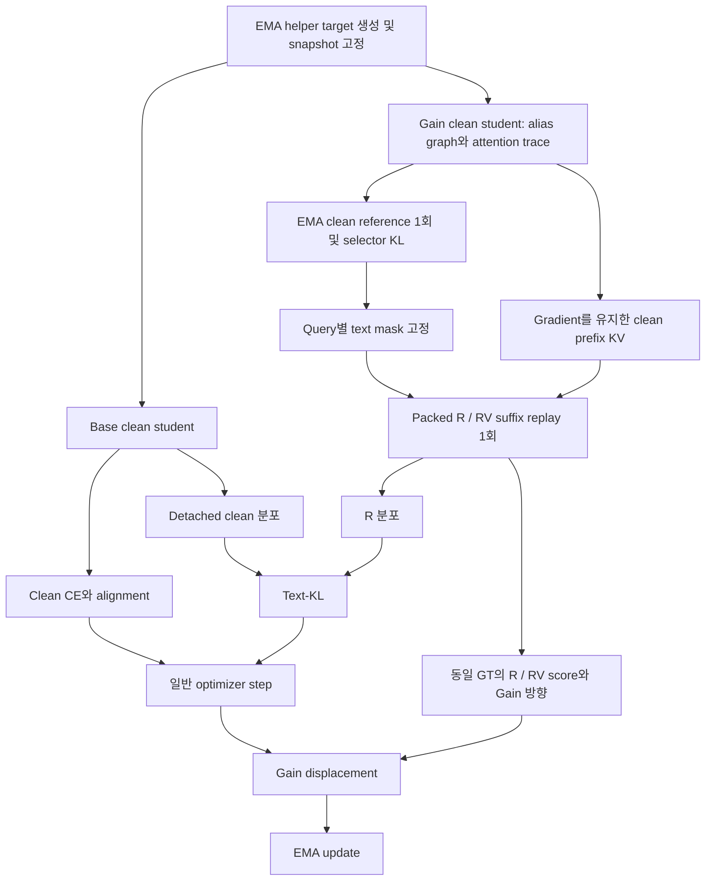

# Text-only Masking + Gain + Text-KL 명세 v1

버전: v1.1 — 새 서버·새 workspace에서 구현하기 위한 독립 명세. 기준 모델은 Qwen2.5-VL-3B-Instruct다.

모든 파일 링크는 명세서 옆의 `text_only_gain_v1/` 폴더를 기준으로 한다. 두 항목을 함께 옮기면 임의의 workspace에서도 링크가 유지된다. [자료 구성과 통합 안내][bundle-index], [파일 목록][bundle-manifest]를 함께 참고한다.

## 1. 핵심 아이디어와 문서 범위

**이전 추론 텍스트의 일부를 읽지 못하게 한 상태에서도, visual latent가 다음 정답 텍스트 예측에 도움이 되도록 학습한다. 동시에 그 상태의 예측 분포를 원래 clean 예측에 가깝게 유지한다.**

예를 들어 모델이 앞서 쓴 설명만 읽고 다음 답을 낼 수 있다면 latent를 사용할 필요가 작아질 수 있다. 이 방법은 다음 세 장치를 결합한다.

1. **Text-only masking:** 현재 latent 앞의 assistant 추론 텍스트 중 일부에 대한 직접 attention을 차단한다.
2. **Conditional Gain:** 같은 텍스트 제약에서 latent를 읽을 수 있는 `R`과 읽지 못하는 `RV`를 비교하고, latent의 조건부 기여가 커지는 방향으로 파라미터를 보정한다.
3. **Text-KL:** `R`의 전체 어휘 예측 분포를 현재 student의 clean 예측에 맞춘다. 이는 텍스트 제약 아래의 예측을 유지하도록 하는 일관성 손실이다.

Text-only는 **마스킹 대상이 텍스트뿐**이라는 뜻이다. 원본 이미지 입력과 latent는 사용한다. 학습 중에도 새로운 rejected 응답을 생성하지 않고 **동일한 GT 텍스트**를 teacher forcing으로 비교한다.

이 문서는 Text-only masking, conditional Gain, Text-KL의 연산과 구현 계약을 정의한다. 전체 원본 이미지 마스킹 및 entropy 기반 예산은 범위 밖이다. `source/`는 이 계약을 이해하고 새 코드에 통합하기 위한 참고 구현이며, 특정 서버의 설치 위치나 Git 상태를 전제하지 않는다. §11의 수치는 기존 비교 결과로, 새 workspace에서 재현되었다는 뜻은 아니다.

## 2. 구현 기준 설정

| 항목 | 기준 설정 |
| --- | --- |
| Base model / 초기화 | Qwen2.5-VL-3B-Instruct, pretrained base에서 새로 시작, resume 없음 |
| 학습 방식 | DoRA, rank 32, adapter alpha 64, dropout 0.05 |
| 학습 데이터 | [data/TRAIN.jsonl][train-data], 3,450 samples |
| 학습 길이 | 3 epochs, 1,296 optimizer updates, 마지막 불완전 accumulation 포함 |
| Learning rate | `5e-5`, optimizer LR warmup 10 steps |
| 분산 / 정밀도 | 2 GPUs, ZeRO-1, BF16, SDPA, gradient checkpointing |
| Batch | GPU당 microbatch 1, accumulation 4; 완전한 update의 global batch 8 |
| Seed / 최대 sequence 길이 | 42 / 32,768 |
| EMA | moving, decay `0.999` |
| Latent / helper | `latent_size=8`, `coverage_p=0.9`, `helper_group_L=256` |
| 기본 손실 가중치 | CE `1.0`, alignment `1.0` |
| Gain | displacement coefficient `α=0.001`, `execution=packed`, `branch_mode=independent` |
| Text-KL | `β_max=0.01`, warmup ratio `0.05`, temperature `τ=2.0` |
| Clean-KL / IIER | `clean_kl_beta=0`, `preference_mode=none` |
| 텍스트 예산 | `rho_min=0.3`, `rho_max=0.5`, token cap ratio `0.3` |
| 텍스트 fallback | candidate attention mass `<0.1`일 때 후보 수의 `floor(0.1N)`개 |
| 이미지 마스킹 | `image_max_mask_ratio=0.0`; 전체 이미지 강제 차단도 사용하지 않음 |

전체 학습 설정은 [training.json][launch], 마스킹 설정은 [prefix-conditioning.json][prefix-config]에 정리했다. 학습 설정 파일은 새 launcher에 값을 전달하기 위한 선언적 명세이며, 그대로 실행하는 command나 기존 launcher의 manifest가 아니다. Text-KL warmup과 optimizer LR warmup은 서로 다르다. 1,296 updates는 이 데이터·GPU 수·accumulation에 대한 기준값으로, 데이터나 batch 구성을 바꾸면 다시 계산한다.

## 3. 입력, helper latent와 예측 위치

개념적인 interleaved 입력은 다음과 같다.

```text
원본 이미지 / 질문 / ... / S_i  V_i  E_i  T_i / S_(i+1) ...
                            latent block   다음 GT text item
```

| 기호 | 정의 |
| --- | --- |
| `S_i`, `E_i` | 현재 latent block의 start/end marker |
| `V_i` | 두 marker 사이의 latent body 전체 |
| `T_i` | 해당 block 바로 뒤에 붙는 하나의 GT text item |
| `U_i` | `T_i` 안에서 실제 Gain 점수를 계산하는 유효 GT target 위치 |
| `q=t−1` | target 위치 `t∈U_i`를 예측하는 decoder query 위치 |
| `C_i` | 현재 `S_i` 이전의 assistant 추론 텍스트 후보 위치 집합 |
| `H_q` | query `q`에서 읽지 못하도록 선택한 텍스트 key 집합 |

`U_i`는 padding, `labels=-100`, 구조 토큰, latent 위치, text-item 경계를 걸치는 토큰을 제외한다. 유효 target이 없는 block은 Gain에서 제외한다. 점수 범위는 임의의 전체 답변이 아니라 **현재 block 바로 다음 text item**이다. 첫 target이 `E_i` 바로 다음에 있으면 이를 예측하는 query는 `E_i` 위치다.

기존 Stage 1 helper target 생성은 유지한다. EMA teacher가 helper image feature를 만들고, 질문·앞선 텍스트·직전 선택 feature에서 얻은 query와의 cosine similarity로 후보를 정렬한다. Softmax 누적 질량 `coverage_p=0.9`와 사용 가능한 latent slot 수에 따라 feature를 선택한다. 선택 결과는 detach하여 student latent 위치에 주입한다. 이 snapshot을 base, Gain, reference 경로가 공유하며 경로마다 다시 뽑지 않는다.

학습 시 latent 입력은 이 helper target이다. `R/RV` 비교를 위해 latent 값을 autoregressive하게 다시 생성하지 않는다. 정상 평가의 self-generated latent 추론과 학습의 teacher-input 경로는 구분해야 한다.

근거: [targets.py][targets-code], [vision_gain.py][gain-code], [prefix_mask_metadata.py][metadata-code].

## 4. F, R, RV와 EMA reference

| 경로 | 텍스트 `H_q` 접근 | 현재 latent body 접근 | 역할 |
| --- | --- | --- | --- |
| `F`: clean student | 허용 | 허용 | Base CE/alignment 및 Text-KL target |
| Gain clean student | 허용 | 허용 | 별도 alias graph의 clean prefix KV와 attention 통계 |
| `R`: restricted, latent-on | 해당 scored query에서 차단 | 허용 | Gain positive score와 Text-KL 학습 분포 |
| `RV`: restricted, latent-off | `R`과 동일하게 차단 | 해당 branch replay에서 차단 | Gain negative score |
| EMA clean reference | 허용 | 허용 | 마스킹 예산을 정하는 KL의 reference |

`F`와 Gain clean은 같은 clean 조건을 뜻하지만, optimizer gradient와 Gain gradient를 분리하기 위해 **서로 다른 forward/graph**로 계산한다. Gain clean에는 base 실행 전 RNG를 복원한다. Student는 train mode를 유지하고, R/RV의 같은 원래 token 위치에는 대응되는 dropout realization을 사용한다. EMA reference는 eval/no-grad다.

Text-KL target은 **현재 student의 base-clean 출력**이다. EMA teacher의 출력은 마스킹 예산에 쓰며, Text-KL target으로 대체하지 않는다.

## 5. Text-only 마스킹 선택 규칙

### 5.1 후보와 attention

블록 `i`의 텍스트 후보는 다음과 같다.

\[
C_i=\{k\mid k\text{는 assistant reasoning의 일반 text token이고 }k<S_i\}.
\]

사용자 질문 전체나 현재 latent 뒤의 `T_i`를 마스킹 후보로 삼지 않는다. Special token과 경계를 걸치는 토큰도 후보에서 제외한다. 같은 block의 query들은 후보 집합을 공유하지만 선택 결과 `H_q`는 query마다 다를 수 있다. 후보가 없는 경우에는 빈 mask를 허용한다.

기존 Gain clean forward 내부 observer가 attention을 수집한다. 전체 causal key에 대한 softmax 후 head 평균, layer 평균을 적용한다.

\[
a_{qk}=\frac1L\sum_{\ell=1}^{L}\frac1{n_h}\sum_{h=1}^{n_h}A^{\ell,h}_{qk},
\qquad M_q=\sum_{k\in C_i}a_{qk}.
\]

후보 텍스트만으로 attention을 다시 softmax하지 않는다. 선택 통계는 detach하며, 이를 얻기 위한 별도 decoder replay는 없다.

### 5.2 Clean student–EMA KL로 attention 질량 예산 결정

동일한 teacher-latent snapshot과 clean 문맥에서 얻은 Gain clean student logits `z_G`와 EMA reference logits `z_E`를 사용한다. Full vocabulary, FP32 계산이다.

\[
p_q=\operatorname{softmax}(z_{G,q}/\tau),\quad
r_q=\operatorname{softmax}(z_{E,q}/\tau),\quad \tau=2,
\]
\[
d_q=\tau^2\operatorname{KL}(p_q\|r_q),\qquad
u_q=-\log(\max(d_q,0)+10^{-6}),
\]
\[
\rho_q=0.3+0.2\,\sigma(u_q-\overline u_b).
\]

`ū_b`는 **같은 sample의 모든 Gain-valid GT query**에 대한 평균이다. Block별 평균이 아니다. 이 실험의 sigmoid scale은 1이다. Sample 내에서 상대적으로 KL이 작은 query에 더 큰 마스킹 예산을 준다. 여기서 `ρ_q`는 **후보 attention 질량의 목표 차단 비율**이며, 텍스트 token 수의 비율이 아니다.

이 KL과 선택 과정에는 gradient를 흘리지 않는다. Entropy, GT NLL 또는 고정 예산으로 치환하지 않는다.

### 5.3 실제 key 선택과 cap

`N=|C_i|`, `cap=floor(0.3N)`으로 둔다. 후보를 `a_qk` 내림차순으로 정렬하고, 동률이면 원래 token 위치가 앞선 것을 우선한다.

| 조건 | 선택 규칙 |
| --- | --- |
| `M_q ≥ 0.1` | 누적 attention이 `ρ_q M_q` 이상이 되거나 cap에 도달할 때까지 선택 |
| `M_q < 0.1` | 같은 정렬에서 `min(cap, floor(0.1N))`개 선택 |
| 후보 없음 / cap 0 | 빈 집합 허용; 최소 1개를 강제하지 않음 |

목표 질량을 넘기는 마지막 token은 포함한다. 예를 들어 후보 20개이면 최대 6개까지 가리며, low-attention fallback이면 2개를 가린다. 예산이 `ρ=0.4`라고 해서 항상 8개를 가리는 것은 아니다.

이 실험은 `image_max_mask_ratio=0`이므로 원본 이미지 key의 선택 집합은 비어 있다. 코드에 image attention proxy 계산이 있어도 이 실험에서 이미지를 차단했다는 의미는 아니다.

구현 참고: [selector][selector-code], [reference 실행][reference-code], [attention observer][trace-code], [prefix 설정][prefix-config].

## 6. 같은 텍스트 제약의 R/RV 비교

선택한 `H_q`를 고정하고 R/RV 양쪽에 동일하게 적용한다.

- **R:** scored GT query `q`에서 `H_q` key로 향하는 attention edge를 차단한다.
- **RV:** R의 차단에 더해 현재 latent body `S_i < k < E_i`로 향하는 attention을 해당 branch의 replay 행 전체에서 차단한다.
- V-off는 latent body 전체에 적용하며, helper가 실제 주입된 위치만 골라 차단하는 방식이 아니다. Latent start/end marker는 body 차단에 포함하지 않는다.
- 입력 token, embedding, sequence 길이, 원래 position ID를 유지한다. Attention additive mask에 `−∞`를 적용하는 개입이다.

이 실험의 `independent`는 **block마다 독립적인 R/RV 분기**를 만든다는 의미다. 앞선 block의 마스킹을 누적하지 않는다. 현재 latent end 이전의 clean prefix KV를 공유하고, latent end부터 마지막 유효 target의 prediction query까지 필요한 suffix를 재계산한다. R/RV suffix들을 한 packed decoder 호출에 함께 넣는다.

공유 prefix KV는 detach하지 않는다. 따라서 R/RV 점수와 Text-KL gradient가 해당 prefix의 파라미터 계산으로도 흐른다. 반면 마스크를 고르는 통계와 helper target은 detach한다.

이 개입은 직접 attention edge를 제한한다. 다른 prefix hidden state에 이미 들어간 텍스트·이미지 정보까지 모두 제거한다는 의미는 아니다. 원본 이미지 접근도 유지되므로, 모델이 오직 latent만으로 문제를 풀도록 강제하는 구조는 아니다.

근거: [conditioned packing 및 mask][conditioning-code], [packed 실행][packed-code].

## 7. 손실과 파라미터 업데이트

### 7.1 일반 optimizer 손실

\[
L_{\mathrm{opt}}=L_{\mathrm{CE}}+L_{\mathrm{align}}+\beta(s)L_{\mathrm{textKL}}.
\]

`L_CE`는 base clean 경로의 유효 label에 대한 next-token CE다. Sample별 유효 token 평균 후 sample 평균을 취한다. `L_align`은 선택된 latent target 위치 `t`에 대해 직전 위치의 hidden state `h_(t−1)`가 detached helper 입력 feature를 예측하도록 하는 cosine 손실이다.

\[
L_{\mathrm{align}}=\operatorname{mean}_{b}
\operatorname{mean}_{t\in\mathcal V_b^{\mathrm{selected}}}
\left[1-\cos\left(h_{b,t-1},\operatorname{sg}(v_{b,t})+0.01\epsilon_{b,t}\right)\right],
\quad \epsilon\sim\mathcal N(0,I).
\]

Alignment 대상이 없는 sample은 구현상 0을 기여한다. CE와 alignment의 계수는 각각 1이다. 별도의 R 경로 GT CE나 Clean-KL은 이 실험의 optimizer 손실에 추가하지 않는다.

### 7.2 Text-KL: clean 예측을 masked reader에 전달

Sample `b`의 Gain-valid GT prediction query 집합을 `Q_b`, 이 집합이 비어 있지 않은 sample 집합을 `B_+`라 하자.

\[
p_{F,bq}=\operatorname{softmax}(z_{F,bq}/\tau),\qquad
p_{R,bq}=\operatorname{softmax}(z_{R,bq}/\tau),
\]
\[
L_{\mathrm{textKL}}=
\frac1{|B_+|}\sum_{b\in B_+}\frac1{|Q_b|}\sum_{q\in Q_b}
\tau^2\operatorname{KL}\left(\operatorname{sg}(p_{F,bq})\|p_{R,bq}\right).
\]

Full vocabulary를 사용하고, **clean target은 detach**, R 쪽만 미분한다. R은 latent-on positive branch다. RV 분포나 EMA 분포를 Text-KL 학습 대상으로 사용하지 않는다. 같은 query의 중복 사용·누락은 오류로 처리한다. 선택된 text mask가 빈 query도 손실에 포함한다.

Reduction은 **sample 내 query 평균 후 유효 sample 평균**이다. 아래 Gain의 block 평균과 다르다. Temperature는 selector와 동일한 `τ=2`이며, raw Text-KL 값에 이미 `τ²=4`가 포함된다.

완료 optimizer step 수를 `s`, 계획된 총 step 수를 `S=1296`이라 하면 다음과 같다.

\[
W=\lceil0.05S\rceil=65,\qquad
\beta(s)=0.01\min(1,s/65).
\]

첫 update를 계산할 때 `s=0`이므로 가중치는 0이다. 65 updates가 완료된 시점부터 최대 가중치 0.01을 사용한다.

### 7.3 Conditional Gain 점수와 reduction

같은 GT token `y_t`의 log probability를 비교한다. Gain 점수에는 KL용 temperature를 적용하지 않는다.

\[
S_{R,i}=\frac1{|U_i|}\sum_{t\in U_i}\log p_\theta(y_t\mid R_i),\quad
S_{RV,i}=\frac1{|U_i|}\sum_{t\in U_i}\log p_\theta(y_t\mid RV_i).
\]

여기서 각 조건은 원래 autoregressive 위치와 동일한 GT prefix를 사용한다. 각 score는 full-vocabulary FP32 log-softmax의 GT 성분이다. Accumulation window의 모든 GPU에 걸친 유효 block 수를 `B_G`라 하면:

\[
G=\frac1{B_G}\sum_i(S_{R,i}-S_{RV,i}),\quad
g=\nabla_\theta G,\quad
h=\nabla_\theta\left[\frac1{B_G}\sum_iS_{RV,i}\right].
\]

Local gradient 합을 FP32로 모으고, rank 간 합산 후 전역 block 수로 나눈다. 긴 text item이 score 자체에서 더 큰 가중치를 갖지 않도록 block 안에서는 token 평균을 먼저 취한다. 다만 block 수가 많은 sample은 Gain에서 더 많이 기여할 수 있다.

### 7.4 Gain projection과 optimizer 후 displacement

Gain은 `−αG`를 AdamW loss에 더하는 방식으로 구현되지 않는다. 별도의 gradient 방향을 계산하고 일반 optimizer step 뒤에 직접 적용한다.

\[
u=\begin{cases}
g-\dfrac{h^\top g}{\|h\|^2}h,& h^\top g<0\ \text{이고}\ \|h\|^2\ge10^{-30},\\
0,&0<\|h\|^2<10^{-30},\\
g,&\text{그 외}.
\end{cases}
\]

`hᵀg<0`이면 RV score를 일차 근사에서 떨어뜨리는 성분을 제거한다. 따라서 Gain 차이를 키우기 위해 RV를 단순히 악화시키는 방향을 제한한다. 이것은 보정 방향에 대한 국소적인 일차 조건이며, optimizer 전체 update 이후의 점수나 최종 정확도를 보장하지 않는다.

업데이트 순서는 다음과 같다.

\[
\theta' = \operatorname{AdamWStep}(\theta,\nabla L_{\mathrm{opt}}),\qquad
\theta_{\mathrm{new}}=\theta'+0.001u,
\]
\[
\theta_{\mathrm{EMA,new}}=0.999\theta_{\mathrm{EMA}}+0.001\theta_{\mathrm{new}}.
\]

EMA 수식은 구현이 관리하는 대응 trainable parameter에 적용한다. `u`는 optimizer step 이전 파라미터에서 계산한다. `α`는 learning rate와 별개의 displacement 계수이며 Adam moment에 넣지 않는다. ZeRO-1에서는 FP32 master parameter에 보정하고 low-precision parameter를 동기화한다. 실패하거나 skip된 optimizer update에는 Gain 및 EMA 갱신을 적용하지 않는다.

최종 Gain metadata에는 1,296 updates 중 1,040회 projection, tiny-norm skip 0회, zero-direction 0회가 기록되어 있다. 이는 실행 기록이며 성능 향상의 인과적 증거는 아니다.

근거: [Trainer loss/update][trainer-code], [Text-KL 구현][text-kl-code], [Gain projection][gain-code], [gradient 집계와 displacement][gain-update-code], [EMA][ema-code], [최종 Gain metadata][gain-meta].

## 8. Gradient 분리와 Text-KL 전달 구현

Packed Gain은 실제 optimizer parameter에서 `detach().requires_grad_(True)`로 만든 alias를 `functional_call`에 넣는다. 파라미터 값은 동일하지만 base graph와 별도 graph다. 따라서 R에서 계산한 Text-KL gradient를 실제 optimizer parameter로 전달해야 한다.

1. `S_R`와 `L_textKL`의 두 VJP를 `torch.vmap(..., randomness='same')`의 두 cotangent lane으로 함께 계산한다.
2. 기존 `S_RV` gradient는 다음 VJP에서 계산한다. Gain의 positive/negative gradient는 원래대로 별도 축적한다.
3. Text-KL gradient를 detach하여 저장한다. Custom autograd scalar는 forward에서 KL 값을 반환하고, ordinary backward에서 저장한 gradient를 실제 optimizer parameter에 전달한다.
4. 이 전달에는 `β(s)`, accumulation scaling, 분산 reduction, clipping 등 일반 optimizer backward의 처리가 적용된다. 전달 단계에서 alias graph를 다시 실행하지 않는다.

Text-KL을 Gain score에 섞지 않으므로 Gain projection의 정의는 유지된다. Shared prefix KV를 거친 Text-KL derivative도 전달 대상에 포함된다. `β=0`인 시작 구간은 기존 Gain VJP만 사용한다.

이 구조는 Text-KL을 위해 세 번째 순차 VJP/checkpoint traversal을 추가하지 않기 위한 것이다. Decoder나 LM-head를 추가로 호출하지 않고 기존 R logits 계산 지점에서 KL을 소비한다. 추가 full-vocabulary 연산, cotangent lane, gradient 저장 비용은 존재하므로 실행 시간과 메모리가 완전히 같다는 뜻은 아니다.

실제 CUDA adapter dropout에서는 vmap과 checkpoint 재계산의 saved-mask 형식을 맞추는 호환 처리가 있다. 해당 dropout의 unbatched activation 연산에서만 `FuncTorchVmapMode`를 제외하고, backward cotangent batching은 유지한다. 지원되지 않는 연산을 별도 serial 재실행으로 우회하는 fallback은 두지 않는다.

근거: [text_kl.py][text-kl-code], [packed executor][packed-code], [기존 Text-KL 구현 설명][existing-text-kl-doc].

## 9. 실행 순서와 forward 비용



유효 Gain block이 있는 **rank당 microbatch**의 최초 핵심 decoder 호출은 다음과 같다.

| 역할 | 호출 수 | 산출물 |
| --- | ---: | --- |
| Base clean student | 1 | CE, alignment, Text-KL clean target |
| Gain clean student | 1 | clean prefix KV, attention trace, selector용 student 분포 |
| EMA clean reference | 1 | selector KL용 reference 분포, no-grad |
| Packed R/RV student replay | 1 | positive/negative score, 기존 R logits의 Text-KL |
| **합계** | **4** | student 3 + EMA reference 1 |
| Text-KL 추가 decoder / head 호출 | **0** | 기존 logits 재사용 |

이 4회에는 **공통 helper-target 생성의 teacher 실행, vision encoder 실행, backward checkpoint 재계산을 포함하지 않는다.** `no_grad` reference도 실제 forward 비용으로 센다. Packed 1회에 여러 block과 두 조건의 suffix가 들어가므로 호출 수 4가 전체 계산량이 full forward의 정확히 4배라는 뜻도 아니다. 유효 Gain block이 없는 경로에는 위 4회 표를 그대로 적용하지 않는다.

## 10. 세 종류의 KL과 checkpoint 계약

| 구분 | KL 방향 | Gradient / 용도 | 이 실험 |
| --- | --- | --- | --- |
| Selector KL | Gain clean student → EMA clean reference | 양쪽 detach, text mask 예산 결정 | 사용 |
| Clean-KL | Base clean student → detached EMA clean reference | Base clean student 학습 | `β=0`, 미사용 |
| Text-KL | Detached base clean student → R student | R 및 공유 prefix의 derivative를 optimizer로 전달 | `β_max=0.01` |

새 학습의 checkpoint에는 [stage1_text_kl.json][text-kl-meta]과 같은 Text-KL 전용 계약을 저장한다. Resume 시에는 config와 metadata 일치를 검사한다. Prefix 및 Gain도 branch mode, execution, 마스킹 설정을 저장·검사한다. 첨부한 `reference/checkpoint_metadata/`는 필드 설명을 위한 참고 자료이며 모델 weight나 optimizer state가 없는 까닭에 resume checkpoint로 사용할 수 없다. 새 workspace에서는 pretrained base에서 새로운 run을 시작한다.

**Metadata 해석:** 참고 구현의 prefix metadata에 있는 `objective_integration.add_reader_kd_to_base_loss=false`는 prefix/Gain 모듈의 필드이며 별도 `TextKLConfig`를 반영하지 않는다. 전체 손실에 KL이 없다는 뜻으로 해석하지 않는다. 새 구현은 Text-KL 설정과 실제 `L_opt` 구성을 명시적으로 기록하며, 이 명세에서는 `text_kl_beta=0.01`과 §7의 손실을 기준으로 한다.

모니터링 항목은 `text_kl_raw`, `text_kl_weighted`, `text_kl_beta`, `text_kl_p95`, `text_kl_query_count`, `S_R`, `S_RV`, `G_cond`, projection fraction 등이다. `loss_gain=-G_cond`는 기록용 수치이며 optimizer에 더해진 loss를 의미하지 않는다.

## 11. 비교 기준 성능과 평가 프로토콜

아래는 3 epochs, 1,296 updates 후 final checkpoint의 **기존 비교 결과**다. 동일 [TEST 400개][test-data]를 GPU당 200개로 나누고 seed 42, greedy decoding, `max_new_tokens=4096`, sample당 generation 1회, normalized exact match를 사용했다. 새 실행은 [evaluation.json][eval-execution]의 동일 프로토콜로 자체 final checkpoint를 평가한다.

| 실험 | 정답 수 | 정확도 | Baseline 대비 |
| --- | ---: | ---: | ---: |
| Baseline | 204/400 | 51.00% | — |
| Gain | 201/400 | 50.25% | −0.75%p |
| Text-only masking + Gain | 208/400 | 52.00% | +1.00%p |
| **Text-only masking + Gain + Text-KL** | **217/400** | **54.25%** | **+3.25%p** |

대상 실험의 Creation / Deletion / Update / Selection은 각각 **72/100, 57/100, 40/100, 48/100**, evaluation error는 0건이다. Text-KL 없는 Text-only 실험보다 9문항, 2.25%p 높다.

이 수치는 학습용 마스킹·R/RV replay를 평가 때 반복한 점수가 아니라 final checkpoint의 정상 generation 결과다. 이 비교 하나로 통계적 유의성이나 latent 활용 증가의 인과적 원인이 입증되지는 않는다. Masking은 정보의 모든 우회 경로를 없애지 않고, 학습은 helper-input latent를 사용하므로 self-generated latent의 효과는 별도 근거가 필요하다.

근거: [대상 평가 summary][eval-summary], [평가 실행 설정][eval-execution], [기본 3종 비교][base-comparison], [Text-KL 비교][kl-comparison].

## 12. 새 workspace의 구현 위치와 통합 범위

| 구현 책임 | 근거 파일 / 주요 함수 |
| --- | --- |
| Helper target / 주입할 feature 선택 | [targets.py][targets-code] — `Stage1TeacherTargetBuilder.build`, `_select` |
| GT score 범위 / Gain projection | [vision_gain.py][gain-code] — `build_stage1_gain_plan`, `score_stage1_gain_block`, `project_gain_direction` |
| 텍스트 후보 / query 좌표 | [prefix_mask_metadata.py][metadata-code] — `build_helper_snapshot` |
| KL budget / text key 선택 | [prefix_mask_plan.py][selector-code] — selector 및 KL 계산 |
| EMA reference 1회 | [prefix_mask_reference.py][reference-code] — `score_clean_reference_once` |
| Inline attention trace | [stage1_prefix_trace.py][trace-code] |
| R/RV mask / KV 공유 / packed suffix | [stage1_prefix_conditioning.py][conditioning-code] |
| Alias 실행 / R logits 소비 / RNG | [vision_gain_packed_execution.py][packed-code] |
| Text-KL / joint VJP / gradient 전달 | [text_kl.py][text-kl-code] |
| Rank 집계 / Gain displacement | [vision_gain_update.py][gain-update-code] |
| CE / alignment / optimizer → Gain → EMA | [trainer.py][trainer-code], [ema.py][ema-code] |
| 기존 tensor·gradient 계약 테스트 | [test_text_kl.py][text-kl-tests], [test_selection.py][selection-tests], [test_vision_gain_projection.py][projection-tests] |

### 12.1 경로 규칙

이 명세에서 `W`는 새 서버에서 선택한 프로젝트 루트다. 특정 절대 경로를 요구하지 않는다.

| 위치 | 역할 |
| --- | --- |
| `W/src/`, `W/transformers/` | 기존 시스템과 통합한 Stage 1 구현 및 모델 수정 |
| `W/config/` | 이 묶음의 학습·마스킹·평가 기준 설정 |
| `W/configs/deepspeed_zero1.json` | ZeRO-1 runtime 설정 |
| `W/data/TRAIN.jsonl`, `W/data/TEST.jsonl` | 학습·평가 데이터 |
| `W/data/images_comt/` | 별도로 준비할 원본 이미지 및 helper image |
| `W/models/Qwen2.5-VL-3B-Instruct/` | 별도로 준비할 pretrained 모델·tokenizer·processor |
| `W/checkpoints/<run-id>/` | 새 실행의 checkpoint |
| `W/results/<run-id>/`, `W/logs/<run-id>/` | 새 실행의 결과·로그 |
| `W/venv/ilvr-venv/` | 첨부 launcher를 사용하는 경우의 프로젝트 가상환경 |

참고 구현 `source/`의 **내용**을 W의 대응 위치에 통합한다. `artifact_paths.py`는 `W/src/artifact_paths.py`의 위치에서 W를 구하고, launcher도 자신의 위치를 기준으로 log root를 정한다. 문서 묶음 안의 `source/`에서 곧바로 실행하면 그 디렉터리가 루트가 되므로, 통합을 마친 실행 코드와 참고 자료를 구분한다.

JSONL의 `image_input`과 `sequence_plan`의 helper-image 경로는 `images_comt/...` 형태다. `image_root=W/data`로 해석한다. JSONL만으로는 실제 이미지가 제공되지 않는다.

### 12.2 포함 범위와 실행 전 통합

이 묶음은 핵심 연산의 구현 참고본이며 완전한 실행 checkout은 아니다. `src/main.py`, dataset/template 처리, PEFT·분산 runtime 보조 모듈, 모델 측 latent-rollout/cache 보조 모듈과 Python dependencies를 새 프로젝트에 통합해야 한다. Stock Transformers에 일부 파일만 덮어쓰는 것으로 실행 가능하다고 가정하지 않는다. 상세한 연결 지점은 [자료 안내][bundle-index]에 정리했다.

첨부 launcher의 일반 기본값은 §2의 설정과 다르다. ZeRO-1, SDPA, LR `5e-5`, microbatch 1, accumulation 4, packed/independent Gain, prefix config, Text-KL을 **명시적으로 전달**한다. [training.json][launch]은 값의 기준이며 이를 자동으로 읽는 실행 기능을 제공하지 않는다.

첨부 평가기는 `--image-root`를 받지 않으므로 각 worker의 작업 디렉터리를 `W/data`로 설정하고, 호출자가 `eval.main()` 전에 Python `random`, NumPy, PyTorch의 seed를 각각 42로 초기화한다. 실행 위치·module 검색 경로·sharding 규칙은 [평가 프로토콜][eval-execution]에 명시했다.

새 학습을 시작하기 전에 두 GPU로 실행되는 학습과 final-checkpoint 평가 handoff를 함께 준비한다. 동일한 최종 평가가 이미 있으면 재사용하며, 별도 teacher/reference 분석이나 추가 ablation을 기본 평가에 섞지 않는다.

참고 구현에는 v1 범위 밖 옵션도 있을 수 있다. 이 명세와 `config/`의 설정이 v1의 기준이다. 첨부 소스가 기준 성능을 낸 실행 소스 전체와 동일하다는 인증은 포함하지 않으며, 새 환경에서의 동작과 성능은 통합 후 검증해야 한다. 수식·설정·기존 비교 결과를 환경 이식의 출발점으로 사용한다.

[launch]: text_only_gain_v1/config/training.json
[prefix-config]: text_only_gain_v1/config/prefix-conditioning.json
[peft-meta]: text_only_gain_v1/reference/checkpoint_metadata/stage1_peft_metadata.json
[gain-meta]: text_only_gain_v1/reference/checkpoint_metadata/stage1_vision_gain.json
[text-kl-meta]: text_only_gain_v1/reference/checkpoint_metadata/stage1_text_kl.json
[eval-summary]: text_only_gain_v1/reference/evaluation_summary.json
[eval-execution]: text_only_gain_v1/config/evaluation.json
[base-comparison]: text_only_gain_v1/reference/comparison.json
[kl-comparison]: text_only_gain_v1/reference/comparison.json
[targets-code]: text_only_gain_v1/source/src/stage1/targets.py
[gain-code]: text_only_gain_v1/source/src/stage1/vision_gain.py
[metadata-code]: text_only_gain_v1/source/src/stage1/prefix_mask_metadata.py
[selector-code]: text_only_gain_v1/source/src/stage1/prefix_mask_plan.py
[reference-code]: text_only_gain_v1/source/src/stage1/prefix_mask_reference.py
[trace-code]: text_only_gain_v1/source/transformers/src/transformers/models/qwen2_5_vl/stage1_prefix_trace.py
[conditioning-code]: text_only_gain_v1/source/transformers/src/transformers/models/qwen2_5_vl/stage1_prefix_conditioning.py
[packed-code]: text_only_gain_v1/source/src/stage1/vision_gain_packed_execution.py
[text-kl-code]: text_only_gain_v1/source/src/stage1/text_kl.py
[gain-update-code]: text_only_gain_v1/source/src/stage1/vision_gain_update.py
[trainer-code]: text_only_gain_v1/source/src/stage1/trainer.py
[ema-code]: text_only_gain_v1/source/src/stage1/ema.py
[existing-text-kl-doc]: text_only_gain_v1/source/docs/stage1-text-kl.md
[text-kl-tests]: text_only_gain_v1/source/tests/stage1/prefix_unit/test_text_kl.py
[selection-tests]: text_only_gain_v1/source/tests/stage1/prefix_unit/test_selection.py
[projection-tests]: text_only_gain_v1/source/tests/stage1/test_vision_gain_projection.py
[bundle-index]: text_only_gain_v1/README.md
[bundle-manifest]: text_only_gain_v1/manifest.json
[train-data]: text_only_gain_v1/data/TRAIN.jsonl
[test-data]: text_only_gain_v1/data/TEST.jsonl